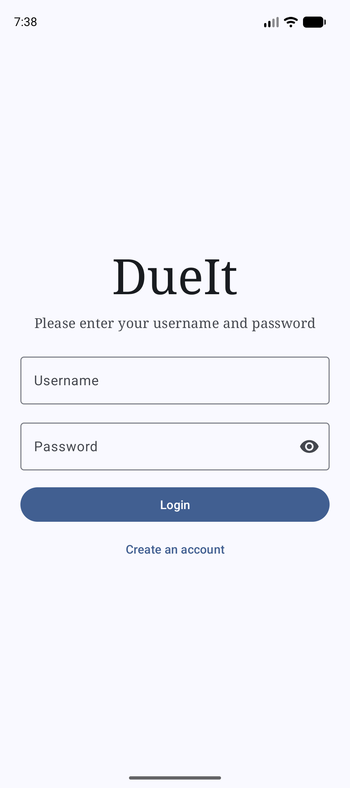
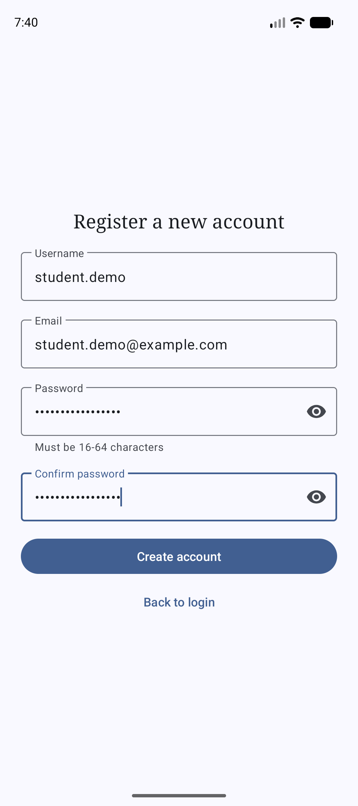
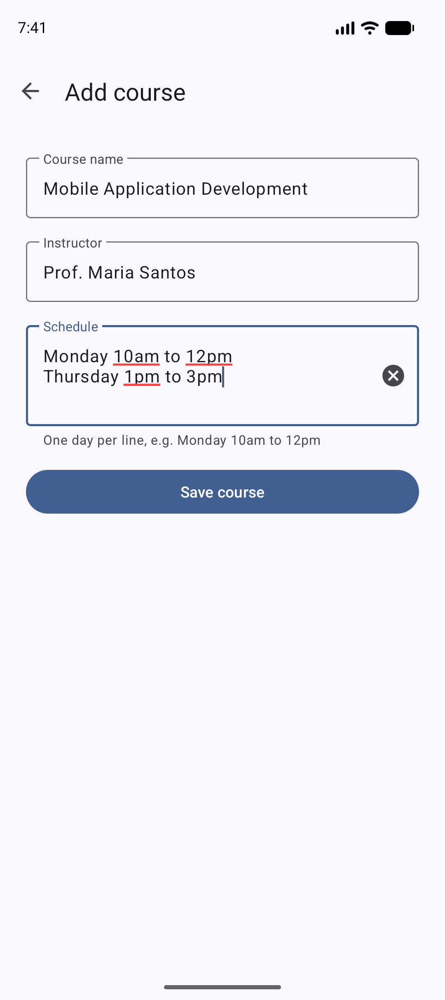
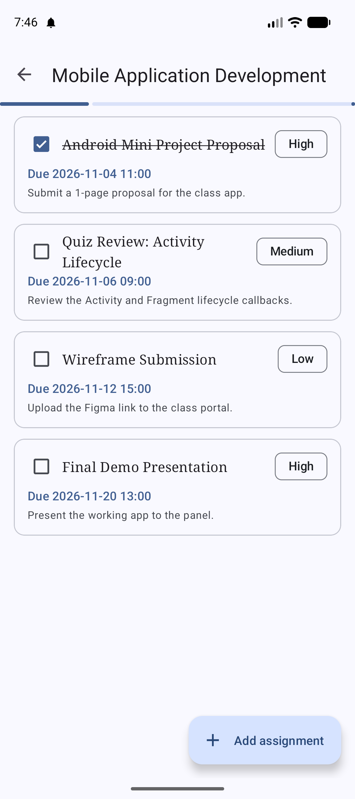
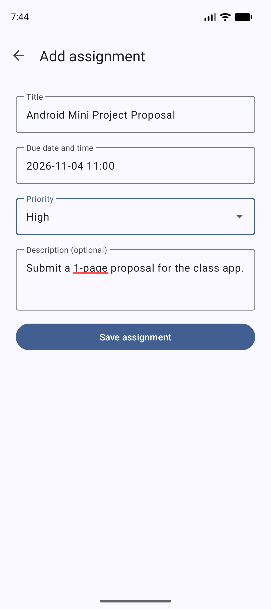

# DueIt

An Android app where students keep track of their courses and assignment deadlines. Add your courses, add assignments with a due date, time and priority, tick them off as you finish them and see your progress for each course. The whole app works offline with no backend.

**Core flow:** Sign up / Log in → Add a course → Add assignments → Mark them done

## About

DueIt is a practice project built in preparation for the Tagisan ng Talino 2026 - 2027 Code Fest hackathon. Everything is stored on the device in SQLite and nothing is fetched from a server.

| | |
|---|---|
| Team Name | ERRAnds |
| Team Members | [Vrixzandro Eliponga](https://github.com/mowtiie), [Michael Tagle](https://github.com/ImmunoCapacity), [Christine Jane Lapuz](https://github.com/chrstnjn) |

## Features

**Registration and authentication**
- Sign up with a username, email and password. The username is unique, 3-30 characters of letters, numbers, `_` or `.`. The email must be valid and the password is 16-64 characters
- Log in by username and password. Passwords are stored as a salted SHA-256 hash

**Courses**
- Add, edit and delete courses with a name, instructor and a multiline schedule
- Each course card shows its details and how many assignments are completed
- Deleting a course also deletes all of its assignments

**Assignments**
- Add, edit and delete assignments with a title, description, due date, due time and priority (Low, Medium or High)
- Dates and times are chosen with Material date and time pickers, and a due date in the past is rejected
- Assignments are listed per course, sorted by due date
- Tick the checkbox on an assignment to mark it Completed, and untick it to set it back to Pending
- A progress bar on the assignment list shows how much of the course is done

**Notifications**
- Saving a pending High priority assignment posts a notification with the title, course and due date
- On Android 13 and newer the notification permission is requested when needed

## Tech specs

| | |
|---|---|
| Language | Java 11 |
| UI | XML layouts, Material Design 3 (Material Components 1.14), view binding |
| Min / target SDK | 24 (Android 7.0) / 36 |
| Build | Android Gradle Plugin 9.2.1 |
| Storage | Local SQLite for students, courses and assignments |
| Theme | Material Theme Builder palette |
| Navigation | One Activity per screen, no fragments |
| Libraries | AndroidX AppCompat, Activity, ConstraintLayout and Material Components only |

## Requirements

- Android Studio (a recent version that supports AGP 9.x) and JDK 11 or newer
- An Android emulator or device running Android 7.0 (API 24) or higher

## Getting started

```bash
git clone https://github.com/mowtiie/DueIt.git
cd DueIt
./gradlew assembleDebug
```

Then open the project in Android Studio and press **Run** on an emulator. The debug APK is created at `app/build/outputs/apk/debug/`.

## Notes

- There is no demo data. Create an account on first launch, then add your own courses and assignments.
- Data is saved in local SQLite and persists across restarts.
- The database is recreated when its version changes, so upgrading across a schema change clears the saved data.
- Notifications fire when a High priority assignment is saved. Nothing is scheduled to remind you later.

## Screenshots

<div align="center">
	<div>
         
         
         
         
         
         
	</div>
</div>

## Release build

```bash
./gradlew assembleRelease
```

To sign the release build, copy `keystore.properties.example` to `keystore.properties` in the project root and fill in your keystore path, alias and passwords. Without that file `assembleRelease` still builds, but the APK is unsigned (`app-release-unsigned.apk`). The signed APK is created at `app/build/outputs/apk/release/`.

Keystore files and `keystore.properties` are git-ignored and must never be committed.

## Verification

APK releases on GitHub are signed using my key. They can
be verified using
[apksigner](https://developer.android.com/studio/command-line/apksigner.html#options-verify):

```
apksigner verify --print-certs --verbose dueit.apk
```

The output should look like:

```
Verifies
Verified using v1 scheme (JAR signing): false
Verified using v2 scheme (APK Signature Scheme v2): true
Verified using v3 scheme (APK Signature Scheme v3): false
Verified using v3.1 scheme (APK Signature Scheme v3.1): false
Verified using v3.2 scheme (APK Signature Scheme v3.2): false
Verified using v4 scheme (APK Signature Scheme v4): false
```

The certificate fingerprints should correspond to the ones listed below:

```
Owner: CN=Mowtiie
Issuer: CN=Mowtiie
Serial number: 8a256fdcdde50069
Valid from: Wed Jun 10 22:57:23 PST 2026 until: Sun Oct 26 22:57:23 PST 2053
Certificate fingerprints:
         SHA1: 56:4E:2C:DB:E4:06:C9:EC:15:E6:BC:D9:0A:88:38:72:8B:FB:13:20
         SHA256: 8B:67:51:F3:C3:31:85:63:5F:98:95:30:B6:C0:73:A1:39:7B:3D:41:2B:EF:AE:69:06:A2:EB:58:45:D2:DE:63
```

**Warning:** Only install DueIt APKs signed with the key above. Verifying the signature confirms you're running a genuine, unmodified build.

### PGP Signing

As an additional layer on top of the Android signature above, each release is also signed with my PGP key. While `apksigner` confirms the APK itself is intact, a PGP signature confirms that *I* am the one who published this specific file to GitHub — an independent check that doesn't rely on GitHub's account security alone.

**Public key fingerprint:**
```
9EA2 8F46 7802 5092 7643 1B69 42B5 FA42 AA63 90E1
```

Download and import the key from my website, or directly from this repo:

```
curl -O https://mowtiie.cc/PGP_PUBLIC_KEY.asc
gpg --import PGP_PUBLIC_KEY.asc
```

After importing, confirm the fingerprint printed by GPG matches the one listed above — that match is what actually establishes trust, not the import step itself. Fetching the key over HTTPS from a domain you already trust is arguably a stronger anchor than a keyserver, since keyservers accept uploads from anyone and don't vouch for identity.

Each release includes a detached `.asc` signature alongside the APK. Verify a downloaded release with:

```
gpg --verify dueit-X.X.apk.asc dueit-X.X.apk
```

A valid signature looks like:

```
Good signature from "Mowtiie <mowtiie.dev@gmail.com>"
```

**Note:** PGP signing is a supplementary trust measure, not a substitute for the `apksigner` check above — verify both if you want the highest confidence that a release is genuine and unmodified.

## License

DueIt is released under the [MIT License](LICENSE).
